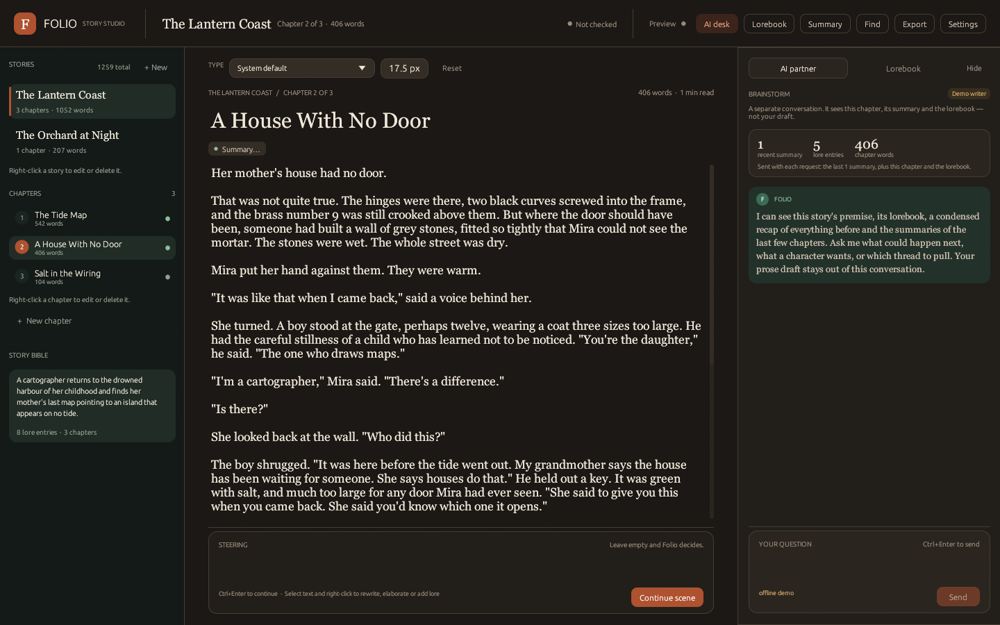
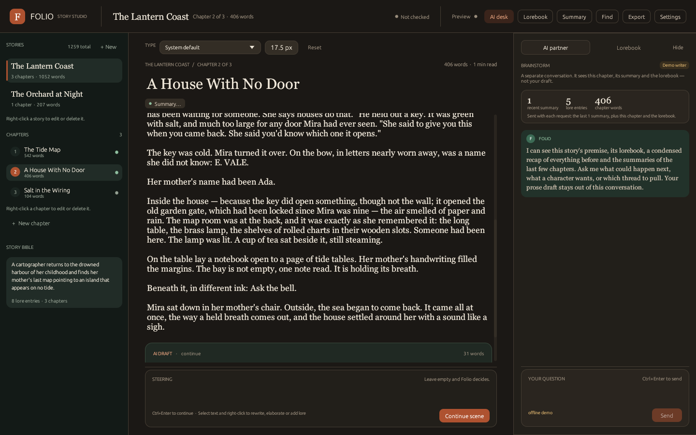
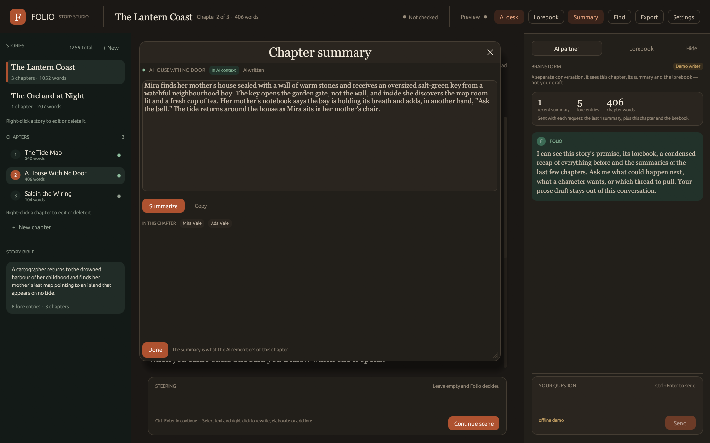
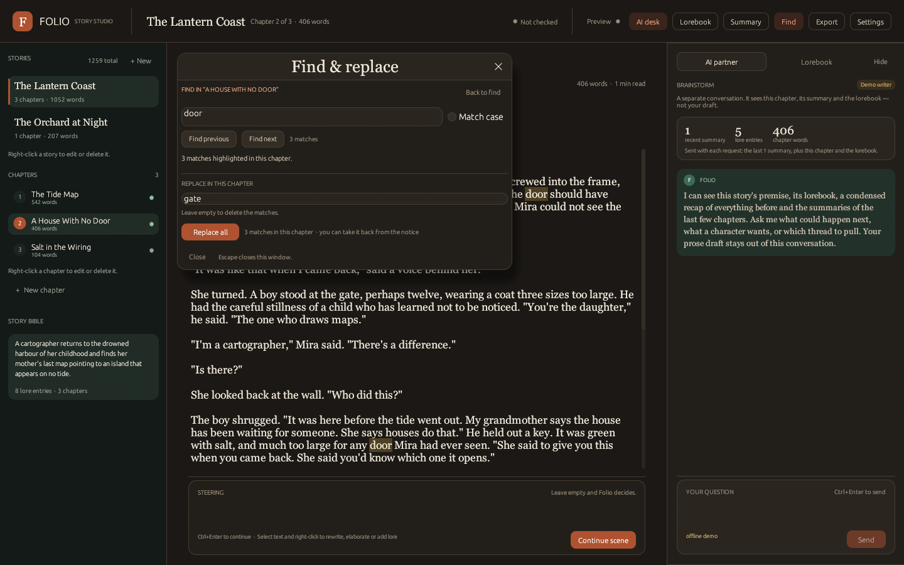
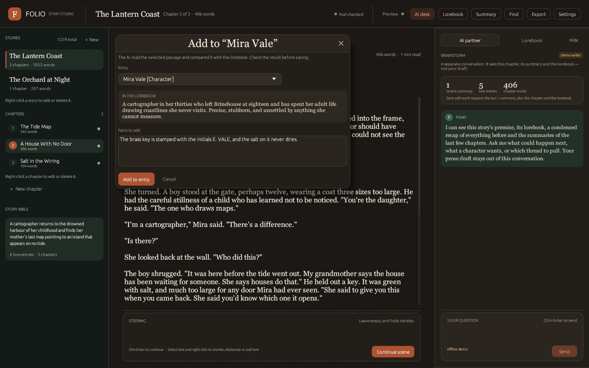

# Folio – Story Studio


**A quiet desktop studio for writing stories with an AI partner.**
A library, a chapter desk, a lorebook and a brainstorming chat – built as a
native Rust application (egui/eframe) for Windows.



> **Transparency:** Folio is a joint human–AI project. The idea, design,
> requirements and sign-off come from **truekry**; the code, tests and
> documentation were written by **DeepSeek V4.1 Flash** in OpenCode. That
> openness is part of the project – the full source is right here.

## What Folio is

Folio is not a word processor, and it is not a chat window. It is a desk for
prose: stories and chapters on the left, the open chapter in the middle, the AI
partner and the lorebook on the right. The AI does not write into the chapter
text; it produces a **draft** that the author accepts or discards. Nothing in
the manuscript changes unless it was explicitly accepted.

The app needs no account and no cloud. It talks to any OpenAI-compatible API –
a local model on your home network as well as a remote service. With no
endpoint configured, a demo writer steps in so you can try everything.

**Status:** version 0.1.0 – an early but usable release. The library and all
features are in place, and changes are saved automatically.

## Features

- **Story library** with chapters, word counts and a story bible (premise,
  lorebook) – all in one local file.
- **Continue scene**: the answer grows as a coloured draft below the chapter.
  Only **Accept** writes it in; next to it are **Delete**, **Retry**, and
  **Stop** while it is still streaming.
- **Steering bar**: a field for the direction of the next continuation. Leave
  it empty and the model decides.
- **Rewrite and Elaborate**: select text, right-click – only the selected
  passage is replaced, with a check that it has not moved in the meantime.
- **Brainstorm chat** per chapter, separate from the chapter text. Long
  conversations are condensed so the context window lasts.
- **Lorebook** with categories, aliases, trigger words and pinning. On request
  the AI suggests new entries from a passage.
- **Summaries** in their own window and as long-term memory. Older chapters
  without a usable summary are caught up on request.
- **Find and replace** in the open chapter or the whole book, with undo.
- **Spelling and grammar** checked paragraph by paragraph, with suggestions
  accepted one at a time.
- **Export** as one PDF for the whole story or one text file per chapter.
- **Endpoint lamp** shows whether the endpoint is reachable, which model
  answers, and how large its context window is.
- **Light and dark** following the system setting, plus system fonts and a
  selectable text size for the desk.

## Download

The Windows build is published on the
[Releases page](../../releases/latest). It is a single portable executable –
double-click, no installation. The file is not code-signed, so Windows
SmartScreen may ask once on first start.

## Connecting your AI partner

In **Settings**:

1. Enter the **endpoint**, for example
   - LM Studio: `http://localhost:1234/v1`
   - Ollama: `http://localhost:11434/v1`
   - KoboldCpp or a llama.cpp server: the respective local address
   - a remote, OpenAI-compatible service
2. Enter the **model** (or pick one from the list the endpoint reports).
3. Optionally an **API key**, if the service requires one. Servers on your own
   network usually do not.
4. **Test connection** turns the lamp in the top bar green once a model answers.
   If the endpoint reports its context window, Folio picks it up automatically.

If the endpoint stays empty, the **demo writer** keeps writing – useful for
trying things out and for screenshots.

## Building from source

Requirements: a current stable Rust (edition 2021). Built and tested with
Rust 1.99.

```bash
cd app
cargo build --release
```

The executable ends up in `app/target/release/folio.exe`.

On Windows, `build.rs` fetches the application icon via `rc.exe` from the
Windows SDK. Without the SDK the project still builds – the executable then
carries the default icon, while the window still shows the Folio logo.

## Tests

```bash
cd app
cargo test
```

125 tests pass on any machine. Five more are integration tests against a real
OpenAI-compatible endpoint; they are marked `#[ignore]` so the normal run stays
offline and fast. Point them at your own endpoint and include the ignored
tests:

```bash
FOLIO_LAN_URL=http://localhost:1234/v1 cargo test -- --include-ignored --test-threads=1
```

`FOLIO_LAN_MODEL` and `FOLIO_LAN_API_KEY` are optional; without a model name the
endpoint's loaded model answers. On Windows PowerShell, set the variable first
with `$env:FOLIO_LAN_URL="http://localhost:1234/v1"`. The tests use the built-in
sample story and need a model that follows instructions; they take about a
minute. The tests cover, among other things, the SSE stream including
cancellation and continuation, the draft lifecycle, prompt composition,
lorebook matching, loading and saving older libraries, file names and the PDF
writer.

## Project layout

```text
app/
├── src/
│   ├── app/        window: top bar, library, editor, right column,
│   │               dialogs and the stateful actions
│   ├── ai/         prompts, endpoint, streaming, lore suggestions, proofreading,
│   │               budgets and the demo writer
│   ├── model/      library, story/chapter/draft, settings,
│   │               saving, file names and export
│   ├── pdf/        small PDF writer without external dependencies
│   ├── theme.rs    colours for day and night
│   ├── fonts.rs    system fonts
│   ├── folder.rs   open a folder in Explorer
│   └── main.rs     startup, window, icon
├── assets/         icons and the Windows resource file
├── tools/          make_icon.py, mock_endpoint.py (for tests)
├── shots/          screenshots
├── build.rs        icon and version data in the executable
├── Cargo.toml
└── Cargo.lock
```

Every submodule brings its own `impl` block for the window state and reaches
the shared types through `use super::*;`. That keeps a change local to one
place.

## Data and privacy

- The library lives in `%APPDATA%\Folio\library.json` (on Linux/macOS:
  `~/.folio/library.json`).
- The file is readable JSON and **also contains the endpoint address, the model
  name and, if set, the API key in plain text**. Keep it out of repositories
  and out of cloud backups you share.
- Folio sends no telemetry. Network traffic goes only to the configured
  endpoint.
- If a library file cannot be read, Folio makes a copy as `library.json.bak`
  before overwriting it.

## Screenshots

| Draft below the chapter | Summary in its own window |
| --- | --- |
|  |  |

| Find and replace | AI lore suggestion |
| --- | --- |
|  |  |

More images are in `app/shots/`, among them `main-light.png` for the light
theme and `prompts-dark.png` for the prompt editor.

## Origin and authors

Folio is an example of how far human direction and AI code can come together –
and where the line stays.

- **truekry** – idea, design, requirements, choice of features, tests and
  sign-off. Every decision about what the app should do and what is good enough
  came from here.
- **DeepSeek V4.1 Flash** – code, tests and documentation, written together
  with the author in OpenCode. That includes the move from one large file to
  today's module layout and the bug hunt with regression tests.

The source is deliberately not hidden as "generated by an AI": the modules are
commented, the tests are readable, and anyone who wants to work on this should
be able to do so with the full picture.

## License

MIT – see [`LICENSE`](LICENSE).

Copyright © 2026 truekry and DeepSeek V4.1 Flash.
