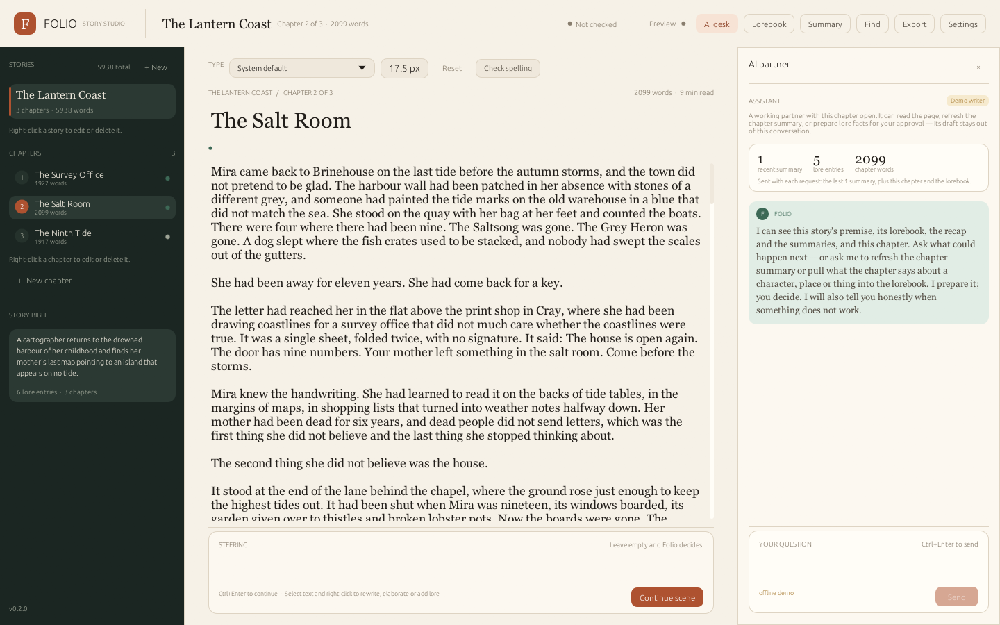
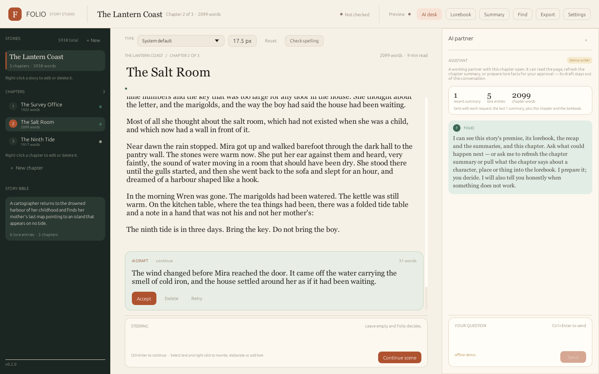
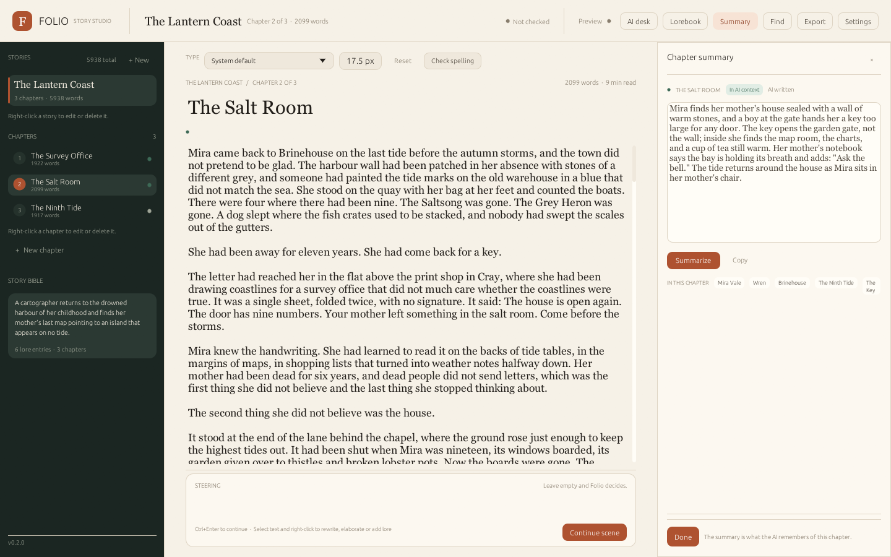
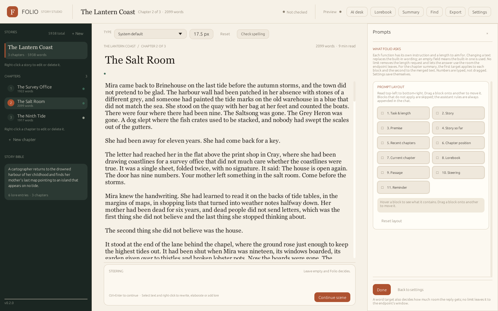
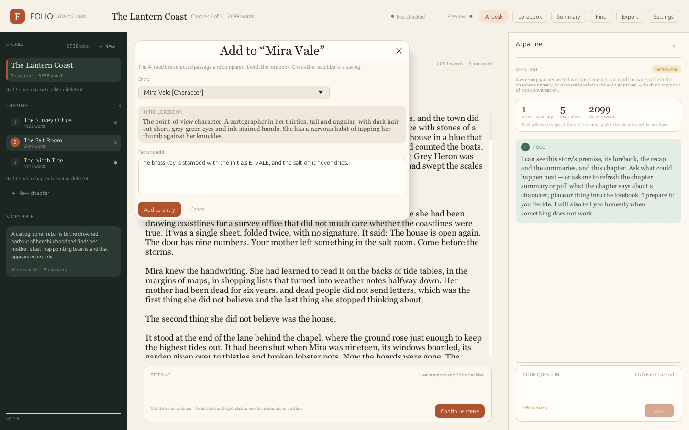
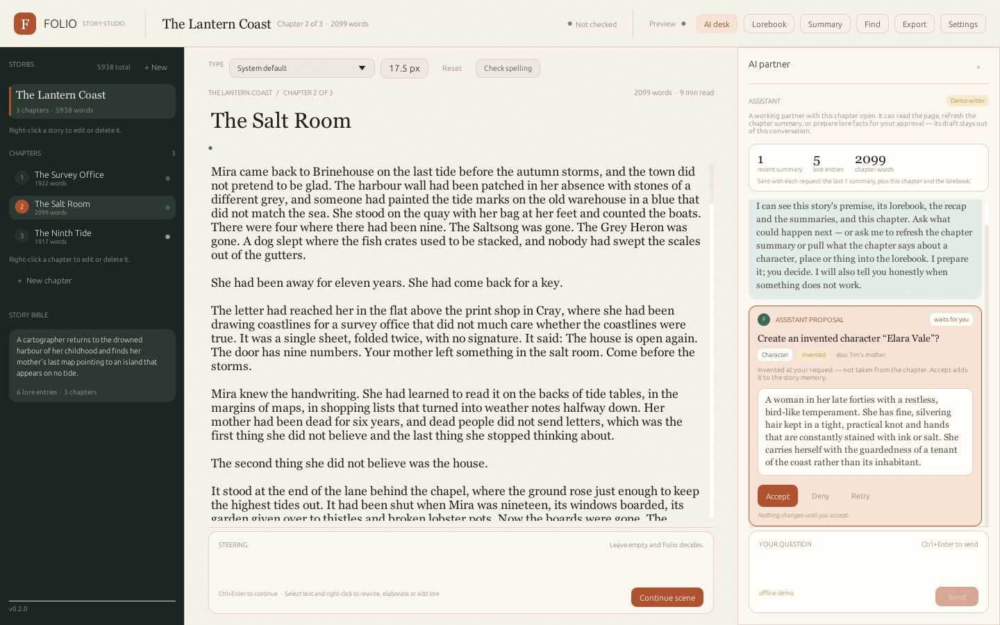
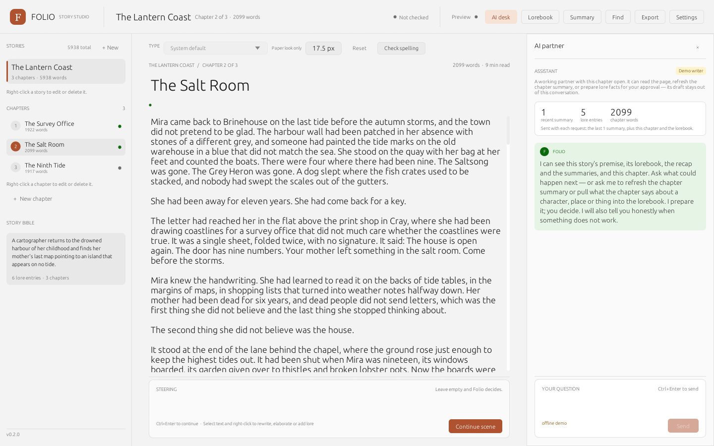
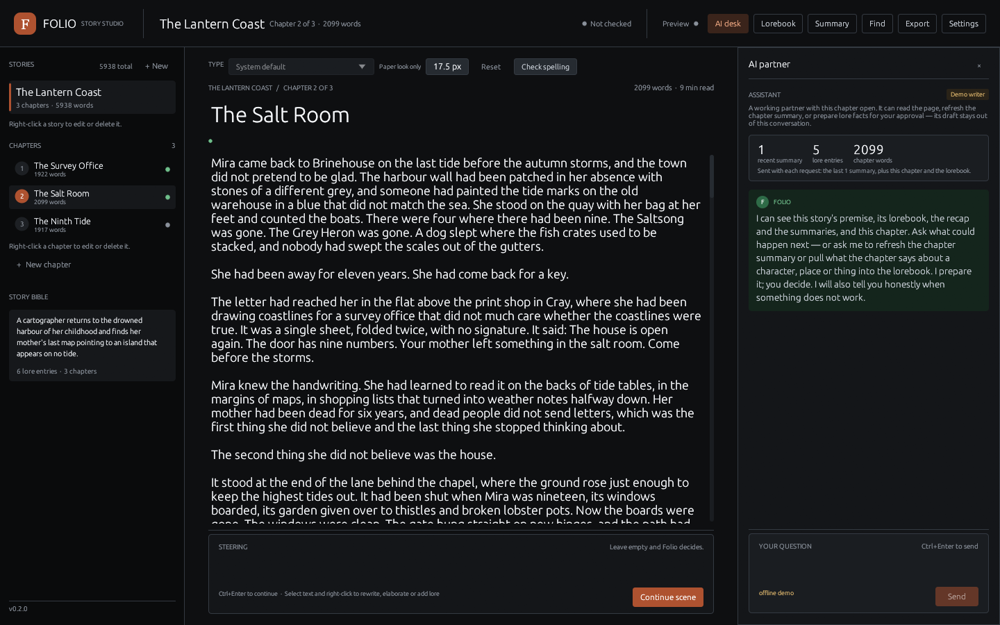

# Folio – Story Studio


**A quiet desktop studio for writing stories with an AI partner.**
A library, a chapter desk, a lorebook and a brainstorming chat – built as a
native Rust application (egui/eframe) for Windows.



> **Transparency:** Folio is a joint human–AI project. The idea, design,
> requirements and sign-off come from **truekry**; the code, tests and
> documentation were written by **DeepSeek V4.1 Flash** in OpenCode. That
> openness is part of the project – the full source is right here.

## What Folio is

Folio is not a word processor, and it is not a chat window. It is a desk for
prose: stories and chapters on the left, the open chapter in the middle, the AI
partner and the lorebook on the right. The AI does not write into the chapter
text; it produces a **draft** that the author accepts or discards. Nothing in
the manuscript changes unless it was explicitly accepted.

The app needs no account and no cloud. It talks to any OpenAI-compatible API –
a local model on your home network as well as a remote service. With no
endpoint configured, a demo writer steps in so you can try everything.

**Status:** version 0.2.4 – an early but usable release. The library and all
features are in place, and changes are saved automatically.

## What is new in 0.2.4

0.2.4 is a maintenance release from a code audit. It fixes data loss, removes a
way for a stray setting to overwrite the API key, and trims the release build.

- **Books are safer on save.** A book file that cannot be read once is now kept
  as a backup instead of being deleted by the next save. Files you place in the
  `stories` folder yourself are left alone.
- **The bin survives a restart.** Deleted stories, chapters and lore entries stay
  in `trash.json` until you put them back. Closing Folio no longer makes a
  confirmed delete permanent.
- **Undo is harder to lose.** A later notice no longer erases the Undo for a
  book-wide replace or a proofreading pass.
- **A stray `FOLIO_VIEW` cannot touch your settings.** Debug screenshot views are
  read only in a debug build; release builds ignore the variable entirely.
- **A leaner executable.** The debug screenshot harness and its sample data are
  no longer present in the shipped binary.
- **Smaller fixes.** Find reuses one search index instead of rebuilding it every
  frame, and titles such as `CON` or `LPT9` no longer break text or PDF export.

Read as a whole: fewer ways for your writing or your settings to be lost.

## Features

- **Drafts you control.** Continue writes into a coloured draft below the
  chapter; only **Accept** changes the manuscript. **Delete**, **Retry** and
  **Stop** sit right beside it.
- **Steering bar.** Tell the partner where the next passage should go — a
  storm, a confession, a quieter scene. Leave it empty and the model decides.
- **Prompt blocks you can thin out.** Two layouts, both with the same gestures:
  **Writing** shapes Continue, **Chat** shapes the assistant. A double-click
  switches a block off and it is no longer sent; the task block always stays on.
  Rewrite and Elaborate ignore the layouts and get their own fixed context.
- **Rewrite and Elaborate.** Select a passage, right-click, and only that
  passage is replaced. The model sees the passage and one paragraph on each
  side — never the whole chapter — and Folio refuses the draft if the text moved
  meanwhile.
- **An assistant that reads this chapter.** A separate chat per chapter can
  discuss the page, propose a new summary, extract lore facts, or invent a new
  character, place or item on request. Every action waits for
  Accept/Deny/Retry; invented entries are marked **invented** in the lorebook.
  The newest message carries a small bin: one click removes exactly that entry,
  so the chat can be rolled back line by line.
- **A lorebook that keeps the story straight.** Categories, aliases, trigger
  words and pinning. Mentioned or pinned entries travel with every request, so
  the AI stops contradicting the book.
- **Chapter summaries.** Every chapter gets its own summary. A long chapter is
  split into blocks of about 1,200 words, each block is summarised on its own,
  and the blocks are merged into one text afterwards. Separate word targets
  apply to the block and to the merged summary. Stopping a run keeps the
  finished blocks as a partial summary.
- **The whole story stays in context.** Those summaries are the AI's memory:
  the most recent ones are sent in full, while everything older is condensed
  into one “story so far” recap. Every request carries the recap, the recent
  summaries and the open chapter. Under **Settings → “Chapter summaries in the
  AI context” → “recent summaries sent in full”** you choose how many of the
  latest chapter summaries are sent in full before the rest is condensed.
- **Proofreading that respects the page.** Spelling and grammar are checked
  paragraph by paragraph; only exact corrections are applied. A model that
  returns advice or a rewrite leaves the paragraph untouched.
- **Export.** One PDF for the whole book, with a contents page and bookmarks,
  or one plain-text file per chapter.
- **Any OpenAI-compatible endpoint.** Local or remote. The lamp in the top bar
  shows whether it answers, which model it serves and its context window. With
  no endpoint, a demo writer keeps the app usable.
- **A layout that fits the work.** One right side panel with eight views,
  two prompt layouts you can arrange and thin out, and three looks: White,
  Paper and Corpo.
- **A key that stays on this machine.** The API key is sealed in `config.json`,
  bound to this computer, your account and a pepper file next to the config.
  Everything else in the file stays readable and editable.
- **One window per library.** A second start does not open another window: it
  brings the running one forward, even out of the taskbar. Two windows writing
  the same books would overwrite each other. The guard belongs to the data
  folder, so a separate test folder can still run beside it.

## Download

The Windows build is published on the
[Releases page](../../releases/latest). It is a single portable executable –
double-click, no installation. The file is not code-signed, so Windows
SmartScreen may ask once on first start.

## Connecting your AI partner

In **Settings**:

1. Enter the **endpoint**, for example
   - LM Studio: `http://localhost:1234/v1`
   - Ollama: `http://localhost:11434/v1`
   - KoboldCpp or a llama.cpp server: the respective local address
   - a remote, OpenAI-compatible service
2. Enter the **model** (or pick one from the list the endpoint reports).
3. Optionally an **API key**, if the service requires one. Servers on your own
   network usually do not.
4. **Test connection** turns the lamp in the top bar green once a model answers.
   If the endpoint reports its context window, Folio picks it up automatically.

If the endpoint stays empty, the **demo writer** keeps writing – useful for
trying things out and for screenshots.

## Building from source

Requirements: a current stable Rust (edition 2021). Built and tested with
Rust 1.99.

```bash
cd app
cargo build --release
```

The executable ends up in `app/target/release/folio.exe`.

On Windows, `build.rs` fetches the application icon via `rc.exe` from the
Windows SDK. Without the SDK the project still builds – the executable then
carries the default icon, while the window still shows the Folio logo.

## Tests

```bash
cd app
cargo test
```

264 tests pass on any machine. Fourteen more are integration tests that need a
real OpenAI-compatible endpoint or a local test setup; they are marked
`#[ignore]` so the normal run stays offline and fast. Point them at your own
endpoint and include the ignored tests:

```bash
FOLIO_LAN_URL=http://localhost:1234/v1 cargo test -- --include-ignored --test-threads=1
```

`FOLIO_LAN_MODEL` and `FOLIO_LAN_API_KEY` are optional; without a model name the
endpoint's loaded model answers. On Windows PowerShell, set the variable first
with `$env:FOLIO_LAN_URL="http://localhost:1234/v1"`. The tests use the built-in
sample story and need a model that follows instructions; they take about two
minutes. The tests cover, among other things, the SSE stream including
cancellation and continuation, the draft lifecycle, prompt composition,
lorebook matching, block-wise summaries and their merge, loading and saving
older libraries, the migration from `library.json` to `config.json` plus one
file per book, story/chapter/lore keys, and the PDF writer.

Some of these tests depend on what the model actually answers. A small local
model may occasionally return a special token or a repetition loop instead of
text; the offline suite is unaffected.

## Project layout

```text
app/
├── src/
│   ├── app/        window: top bar, library, editor, right column,
│   │               dialogs and the stateful actions
│   ├── ai/         prompts, endpoint, streaming, lore suggestions, proofreading,
│   │               budgets and the demo writer
│   ├── model/      library, story/chapter/draft, settings, keys,
│   │               store (config.json, one file per book), the sealed API key,
│   │               the one-instance guard, export
│   ├── pdf/        small PDF writer without external dependencies
│   ├── theme.rs    three looks (White, Paper, Corpo)
│   ├── fonts.rs    system fonts
│   ├── folder.rs   open a folder in Explorer
│   └── main.rs     startup, window, icon
├── assets/         icons and the Windows resource file
├── tools/          make_icon.py
├── shots/          screenshots
├── build.rs        icon and version data in the executable
├── Cargo.toml
└── Cargo.lock
```

Every submodule brings its own `impl` block for the window state and reaches
the shared types through `use super::*;`. That keeps a change local to one
place.

## Data and privacy

- Settings live in `%APPDATA%\Folio\config.json`; every book has its own file in
  `%APPDATA%\Folio\stories\<key>.json` (on Linux/macOS: `~/.folio/`).
- An older single `library.json` is converted once on start. The old file is
  kept as `library.json.migrated-*` next to the new layout.
- These files are readable JSON: the endpoint address, the model name, the
  prompts and every other setting can be read and edited. **Only the API key is
  sealed**: it is stored as `api_key_sealed` and bound to this machine, this
  account and the `secrets.pepper` file next to the config. A copied
  `config.json` opens on no other machine; keep `secrets.pepper` with it, or the
  key must be entered again. This protects the file at rest, not against
  malware running as you.
- Folio sends no telemetry. Network traffic goes only to the configured
  endpoint.
- If a book file cannot be read, Folio sets it aside as `*.broken-*` and keeps
  loading the other books. A broken `config.json` is handled the same way and
  replaced with defaults or the migrated settings.

## Screenshots

| Draft below the chapter | Summary in the side panel |
| --- | --- |
|  |  |

| Prompt layouts | Lore proposal |
| --- | --- |
|  |  |

| Assistant: lore facts | Assistant: invented character |
| --- | --- |
|  |  |

| White look | Corpo look |
| --- | --- |
|  |  |

More images are in `app/shots/`, among them `settings-paper.png`,
`prompts-paper.png`, `prompt-layout-paper.png`, `lore-paper.png`,
`export-paper.png`, `trash-paper.png`, `proofread-paper.png` and
`steering-paper.png`.

## Origin and authors

Folio is an example of how far human direction and AI code can come together –
and where the line stays.

- **truekry** – idea, design, requirements, choice of features, tests and
  sign-off. Every decision about what the app should do and what is good enough
  came from here.
- **DeepSeek V4.1 Flash** – code, tests and documentation, written together
  with the author in OpenCode. That includes the move from one large file to
  today's module layout, the bug hunt with regression tests, the block-wise
  summaries and the split storage with story keys.

The source is deliberately not hidden as "generated by an AI": the modules are
commented, the tests are readable, and anyone who wants to work on this should
be able to do so with the full picture.

## License

MIT – see [`LICENSE`](LICENSE).
